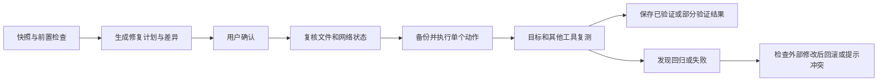

> 本文件保存批准的制作基线/实施计划，历史状态段不代表当前实现。实际完成度见 [STATUS](STATUS.md)。

# Windows Agent 网络与运行环境诊断修复工具：完整制作文档

版本：制作基线 1.2 · 更新日期：2026-10-26（Asia/Shanghai）

已确认需求：首版仅中文，以中国网络下的多 Agent 直连/现有 VPN 或代理共存为主；在启动 Agent 前使用，配置完成后退出，出现新问题再打开；Claude Code 纳入目标。2026-10-26用户要求收敛完整制作文档并准备开工，且从制作开始准备上传GitHub。本版保留已说明的支持条件，不将固定设置宣传为全部网络下的保证。

项目代号：AgentNetDoctor（暂名，发布前核对重名）。状态：制作基线和任务计划已整理，尚未创建产品工程、编写软件或上传GitHub。

实施入口：[逐任务制作与GitHub准备计划](./2026-10-26-windows-network-runtime-implementation-plan.md)。设计以本文件为准，任务顺序以实施计划为准；两者都随项目源码维护，不让后续实施者依赖聊天记录。

需求基线：[Windows 网络与运行环境首版方案](./2026-10-25-windows-network-runtime-mvp.md)。本文件只展开该方案，不实施后续讨论的安装向导、存储地图、多平台或地区专业版。

## 阅读导航

- 先看第 1—4 节：目标、范围、调查结论和技术路线。
- 看第 5—13 节：具体功能、修复边界、交互和架构。
- 看第 14—21 节：安全、测试、里程碑、交付和验收。
- 第 22—25 节：风险、确认点、证据来源和当前审计状态。

## 1. 任务理解与核心目标

### 1.1 要解决的实际问题

用户同时使用 Codex、WorkBuddy、Antigravity，并在部分客户端中调用 DeepSeek API。最新要求增加 Claude Code。调整一个程序的代理或网络设置后，其他程序可能连接失败；VPN 开关也不能稳定解决。

首版目标：在中国网络环境下，启动 Agent 前为各目标检查并配置已验证的网络方式，让使用现有代理的目标与可直连目标同时可用；完成配置后退出。关闭 VPN/代理后，可直连目标仍能使用，不必手工重新调整网络设置，这是必须实测的场景。每次修复都检查其他原本正常的目标，避免互相破坏。

DeepSeek 在本需求中是云端 API 提供商，不计作一个额外的本地监听服务。尚未取得当前机器日志、配置或连接证据，不把现象预设为端口冲突或 VPN 故障。

### 1.2 产品定义

Windows 桌面启动前网络检查与限定配置工具。工作链路为：选定目标与网络方式 → 采集快照 → 检查端口/运行环境 → 授权联网探测 → 输出有证据的问题 → 预览修复 → 确认执行 → 跨工具和 VPN 退出场景复测 → 保存可复用启动配置 → 退出，发生新问题再打开检查。

主要用户：中国网络下同时使用多个 AI 开发工具、需要在使用前配置网络的个人开发者。界面、提示、报告、帮助和验收说明首版均为中文；域名、错误码、配置键和官方错误文本可保留原文。语言资源可保留未来扩展接口，但不交付英文界面。

### 1.3 “优化”的定义

消除配置矛盾、减少重复尝试、识别错误运行环境和缩短排障过程。首版不承诺提高带宽、降低 API 服务端时延或提升模型性能。性能改善必须有前后测量，不能将“换了设置”称为优化成功。

### 1.4 连接方式与退出行为：已确认的选择

每个目标由用户选择“直连”“使用已验证的现有代理”或“仅检查”。不能根据品牌硬编码 Codex/Claude 必须走代理、WorkBuddy/DeepSeek 必须直连；实际可达性、所选服务、账号条件与客户端支持共同决定。

优先生成目标独立的启动环境或使用厂商支持的应用配置。对直连目标，只在客户端已证实支持时隔离继承的代理设置；不能仅清除 HTTP_PROXY 就保证应用不会读系统代理。对代理目标，只配置其受支持的代理机制，不将所有变量无差别设置为同一协议。

软件退出后不保留托盘进程、服务、计划任务、监听器或新的本地代理网关。可复用启动入口只在用户启动目标时短暂执行，完成启动即退出，不充当长期守护者。正常应用进程仍可按原厂机制运行，首版不改变其后台工作模型。

“关闭 VPN 后可直连目标继续可用”的支持条件：该 VPN/代理产品、版本、模式和退出方式经实测，或已验证直连应用与其显式代理隔离，且 VPN 退出恢复可用的 DNS/路由。若退出后残留 DNS、路由、kill switch，或应用强制共用不可隔离的全局代理，程序既已退出就无法主动修复；这种组合必须报告未支持或降级，需要重新打开检查，不能承诺自动兜底。

首版不因 VPN 断开把原先要求代理的服务静默切成直连，也不声称代理可以改变服务地区或账号资格。需要代理的目标在代理关闭时可以明确不可用；验收重点是没有连带破坏可直连目标。

## 2. 第一版范围与支持承诺

### 2.1 必须交付

- Windows 11 x64 中文桌面程序，中文提示、帮助和报告，优先中国网络环境。
- 系统/用户/应用代理配置的分层查看，VPN/TUN、DNS、路由和防火墙只读快照。
- TCP/UDP 本地端口、PID、程序路径与进程身份的关联。
- 目标程序与形态识别，必要运行时、PATH 重名、配置语法、权限和版本范围检查。
- 直连、用户指定现有代理、诊断器默认网络路径的独立探测；明确每种探测实际经过哪一层。
- 基于规则的证据归因；明确未知、未测和权限不足。
- 经适配的进程级/单应用限定修复，以及满足严格条件的当前用户残留手动代理处理。
- 修复预览、备份、并发修改检测、跨工具复测和冲突感知回滚。
- 本机快照、Markdown/JSON 报告与分享预览，不自动上传。

### 2.2 工具与形态

- Codex：CLI、桌面、VS Code 扩展分开识别，不能假定配置一定共用或版本相同。
- WorkBuddy：独立桌面程序；与 CodeBuddy 分开，首版不因命名相似合并。
- Antigravity：用户实际使用的 IDE/桌面形态；CLI 若不是同一产品则独立标识，不代替 IDE 支持。
- Claude Code：首版纳入本机终端交互形态；Desktop Code、WSL/SSH、后台 supervisor 等不同形态先识别并提示边界，不假定同一启动环境全部生效。其官方文档说明终端环境通常在启动时读取，后台会话另有配置继承规则；代理支持也需按版本核实。
- DeepSeek：按实际配置的 API endpoint、协议与调用方检查；官方服务与用户自定义网关分别标记。

未采样实际客户端版本前，不能宣布某个版本“全面支持”。M0 阶段确定至少一组 Windows 环境、四类客户端的具体形态/版本，以及现有 VPN/代理产品、版本、模式和退出方式，写入支持矩阵，之后只对该范围开放修复。新增 Claude Code 的工程量在 M0 复核，不机械沿用旧工期。

### 2.3 支持分级

每个工具/形态/版本分别列出：可发现、可读配置、可诊断、可限定修复、已完成业务验收。不能将“进程存在”宣传为“支持全部功能”。未知版本允许只读查看，默认不执行适配器写操作。

### 2.4 首版不做

安装 Agent/依赖、软件商店、缓存清理、数据迁移、GPU/模型优化、完整存储关系图、VPN 节点管理、分流规则自动重写、抓包解密、驱动安装、流量注入、本地 API 中转、系统网络重置、后台常驻和跨国家远程探测。

Windows 10、ARM64、Windows Server、macOS/Linux 后续单独评估；不承诺所有 Windows 系统。国家资格、API 余额、订阅和服务端故障超出本地修复能力。

## 3. GitHub 调查方法、证据与结论

### 3.1 调查方法与限制

本轮重新搜索了 Windows network diagnostics/proxy、port monitor、per-application proxy 和 agent-doctor 等方向。筛选后读取六个候选的仓库元数据、近期提交、Issue/PR 样本，并对相关候选读取 README、依赖清单和关键源码。

已检查但未运行：全部候选。没有安装、构建、测试软件，没有完成依赖漏洞或供应链审计。Star/Fork 是本次快照，最近 push 不代表功能质量；抽样 Issue/PR 不代表完整社区活跃度；下载量、用户量和性能无法确认。

独立研究附件：[GitHub 调查快照 JSON](./research/github-evidence-2026-10-25.json)。包含六个仓库的统计、默认分支提交 SHA 和活动样本，便于日后复核。

### 3.2 EXboys/agent-doctor

来源：https://github.com/EXboys/agent-doctor

快照：4 Star、4 Fork，MIT，Rust + Tauri/TypeScript，最近 push 2026-10-25。检查默认分支提交：`9389b0b7e7b341ba4b9f809afec1a928dbb2c487`。

匹配：多 Agent 发现、配置解析、诊断、工作区、桌面和修复框架。它是本轮最接近“Agent 管理”的候选，但范围超出网络首版，包括企业连接、工作区、模型配置等。

依赖/部署：core 清单有 20 个跨平台直接依赖及 Windows 专用依赖；desktop 有 5 个运行直接依赖，另有构建工具。整库二开需要 Rust、Node、Tauri 和相应 Windows 构建环境；传递依赖尚未审计。

维护/成熟度：近期有功能提交；抽样 PR 多为机器人依赖更新。README 标注 pre-1.0。公开 Star/Fork 规模较小，不能确认广泛采用。

源码发现：WorkBuddy 适配先寻找 codebuddy，再寻找 workbuddy，配置指向 `.codebuddy/settings.json`；诊断器配置读取失败可落成空 profile，probe 崩溃则 installed=false。这些是实现事实，不足以证明正确识别独立 WorkBuddy，也不符合本产品的状态语义要求。

决策：学习适配器分层、测试与修复审计思路；可以逐文件评估 MIT 小组件；不整库 fork。产品身份、证据状态和跨工具回归仍需自己实现。不能只删除菜单就将复杂产品变成安全的只读诊断器。

### 3.3 Mrxing233/windows-proxy-route-manager

来源：https://github.com/Mrxing233/windows-proxy-route-manager

快照：47 Star、1 Fork，MIT，主分支最近 push 2026-07-29。主分支 `58a4698789433ba36e54aa712ad66090df003230`；桌面源码在 `app-0.1.7`，检查分支头为 `04db1a5b61b020efd22ba23dba0f8753ea95c3fd`。不只检查文档分支就认定代码不存在。

匹配：代理状态、直连/代理比较、路由规则和界面。实际桌面产品围绕 Clash Verge Rev，Tauri/Rust + React；前端清单 4 个运行直接依赖，Rust 清单另有网络、注册表、序列化等依赖。抽样没有 Issue/PR；近期主分支提交主要文档，社区验证证据有限。

关键静态发现：Windows 脚本的“Direct URL Test”用普通 curl.exe，没有显式禁用继承的代理变量；不能据此确认一定绕过显式代理。它也有 SetUserEnv/SetWinHttp 写全局配置选项，超出首版默认范围。

决策：参考系统代理/进程/端口关联与对比流程；不直接执行上游整段脚本，不引入其路由写入逻辑。新探针必须显式选择代理模式，并说明“禁用显式代理”仍不能绕过系统 TUN 路由。

### 3.4 0x0bug/windows-diagnostics-toolkit（WDT）

来源：https://github.com/0x0bug/windows-diagnostics-toolkit

快照：6 Star、1 Fork，MIT，PowerShell，最近 push 2026-09-18。检查提交：`1c0d38962c21933c61e97bbea9fcb37e446f0275`。

匹配：只读适配器/路由/DNS/WinINET/WinHTTP 快照、独立网络信号、脱敏与超时。网络模块约 611 行，PowerShell 5.1/7，README 声明无需第三方 PowerShell 模块。抽样有功能/修复 PR；README 标注 beta。未运行，不能确认所有系统或语言环境可靠。

限制：主要面向综合系统报告，输出以文本/Write-Host 为主；WinHTTP 读取含 netsh 文本，不是本产品需要的类型化代理模型。它的外部 DNS/TCP 探测开关必须明确控制；不是只读就等于完全离线。

决策：本轮最适合参考的采集器。选择性审查并复用 MIT 的小函数/测试模式是可行候选，保留来源和许可证；不默认分发整个系统审计套件，也不执行其远程 bootstrap。主模型与本地服务归因自研。

### 3.5 AmirrezaFarnamTaheri/LucidNet

来源：https://github.com/AmirrezaFarnamTaheri/LucidNet

快照：0 Star、0 Fork，AGPL-3.0，Python/CustomTkinter，最近 push 2026-05-01；提交 `31978c90662afd952c49c4d1edfd29259dcc16c1`。requirements.txt 有 8 个直接运行依赖。抽样只有少量 PR 活动，README 的 v1.0.0 声明不等于经过外部验收。

匹配：Windows 代理、恢复点、脱敏诊断、GUI 和历史。也包含 DNS、DDNS、hosts、托盘和插件，范围明显更大。README 明确当前程序启动提权，特权 broker 仍有待完善方向；抽查 broker 存在直接 dispatcher 路径，不能将设计说明等同于已完成权限隔离。

决策：学习恢复点、历史和失败流程；不整库二开，不复制 AGPL 代码进入拟采用 MIT 的程序。AGPL 本身不表示项目不能使用，而是复用需要遵守对应义务；本项目没有引入这些功能/许可复杂度的必要。

### 3.6 francomano/ProxyDoctor

来源：https://github.com/francomano/ProxyDoctor

快照：1 Star、7 Fork，Go，最近 push 2026-10-17，提交 `72e142baf43450141a2ee854e63e728302ceae72`。API license=NOASSERTION，实际 LICENSE 明确 GPL v3 或后续版本。go.mod 有 2 个直接与 2 个标记间接依赖。

匹配：直连/代理比较、协议识别、TLS 与报告；不覆盖 Windows Agent 的实际生效配置。包含公网 IP/泄漏检查、外部服务、MCP、Web GUI 和本地转发代理。抽样有功能 PR 和覆盖率、发布签名等开放议题，不能只凭 README 宣称全部成熟。

决策：参考可隔离测试的代理探针思路；不内嵌它的服务/MCP/转发器，也不复制 GPL 代码。首版不为了诊断而增加新的监听网关和一组不相关外部探测服务。

### 3.7 wiresock/proxifyre

来源：https://github.com/wiresock/proxifyre

快照：1,594 Star、128 Fork，AGPL-3.0，C++/托管组件，最近 push 2026-10-14；提交 `5e3bc845d73a47a0931b1233c745580cb916f4ba`。有活跃问题/PR，架构依赖 Windows Packet Filter、运行时、服务及相应安装验证，部署和测试明显复杂于诊断软件。

能力：按应用透明代理 TCP/UDP，适合原生不支持代理的软件。但它改变数据路径、引入驱动与系统服务，超出已确定首版。

Issue #187 有 WorkBuddy 代理行为不同、进程环境变量方式可用的用户报告；这是需求线索，不是本机验证或厂商结论。不能把该报告的版本、端口或绕行方法硬编码成通用修复。

决策：作为将来“原生不支持代理时还有哪些路线”的知识参考，不安装、不内嵌、不注入。首版遇到这一边界应说明无法安全自动修复。

## 4. 最终路线决策与技术选型

### 4.1 A/B/C 结论

A 直接使用：各工具能覆盖部分诊断，但没有本轮已查证的成熟项目完整满足“目标客户端 + DeepSeek API + 限定修复 + 跨工具与 VPN 退出复测”。直接使用适合临时排障，不能作为完整交付。此前六仓库统计仍为 2026-10-25 的历史调查快照，不代表新增需求已通过运行验证。

B 整库二次开发：Agent Doctor 功能与依赖面过大；路由管理器绑定特定代理客户端；LucidNet 包含大量可写系统功能；ProxyDoctor/ProxiFyre 又引入另一类服务或数据路径。静态证据下，整库拆改、风险复核和后续同步的收益不明显，不能因为“已有界面”就判断更省成本。

C 小型 Windows 核心自研 + 成熟系统能力复用 + 经审查的 MIT 小组件：推荐。它不是完全从零编写 Windows 网络栈；复用 Windows/.NET 的进程、网络、代理和 TLS 能力，参考上游采集/测试，自己实现目标适配、证据规则与安全修复闭环。

相对之前“优先 B”的调整依据是本轮更深入的候选和源码调查。用户明确授权本轮选择路线；本文件仅提出 C 供审核，尚未按 C 开工。

### 4.2 推荐技术

- C# + WPF，.NET 10 LTS，Windows 11 x64 自包含发行，用户无需另装 Python、Node 或完整 .NET SDK。
- 主要网络/代理读操作采用 Windows API 与 .NET；必要 CIM/PowerShell 补充为固定内置脚本、结构化 JSON、独立子进程，不解析格式化表格。
- 选择 WPF 是因为首版明确 Windows；不为暂缓的跨平台需求引入 Rust + Node + WebView 的额外构建面。
- .NET 10 的 LTS 状态已从官方支持政策核实，具体 SDK/依赖补丁在开工时锁定并记录，不把当前静态调查当作构建结果。[来源 S1]
- 单元/集成测试用 xUnit 或同等成熟框架；JSON 用 System.Text.Json。TOML/JSONC 解析包在 M0 做许可证、维护与解析保真评估后确定；未通过前不开放相关配置写入。
- 无数据库服务器、云服务、远程执行、默认 LLM 推理或插件市场。首版 JSON 快照与受保护备份足够，暂不上 SQLite。

### 4.3 复用纪律

不整库 fork，也不为获取 Star 改名包装。拟复用的每个文件先记录上游 SHA、许可、用途、修改与测试；放入来源清单/THIRD_PARTY_NOTICES。MIT 主许可是建议，最终取决于实际纳入代码和发行依赖。GPL/AGPL 候选仅参考需求和行为设计，不复制代码。任何后续重大依赖/许可证变化重新说明。

## 5. 用户流程与界面

### 5.1 五个主区域

1. 目标：发现并选择工具，允许手动指定可信程序与日志位置，显示形态/版本和支持等级。
2. 本地检查：系统网络快照、端口、运行环境与配置证据；默认不做外网请求。
3. 连接测试：用户勾选目的地与路径，清楚显示即将联网，基础探测不需要凭据。
4. 问题与修复：按受影响工具列出事实、可能原因、缺失证据、具体差异与修复范围。
5. 复测与报告：原目标和其他目标的前后状态、人工业务确认、回滚与导出预览。

不使用单一“健康分数”掩盖未检查项目。首页优先显示“哪些能测、哪些未测”，不默认红色警告所有未安装组件。

### 5.2 三个独立操作

“检查本机”不改变目标配置；“测试连接”执行选定联网探针；“应用修复”只执行已经审阅并确认的动作。创建报告、子进程执行或目标 App 自身写日志可能引起文件变化，因此不宣传全系统绝对零写入。

### 5.3 用户需参与的地方

选目标/网络路径，允许联网与可能计费的最小功能请求，保存并正常退出工作中的 App，确认修复差异，必要时完成官方登录与实际业务验收。不能自动操作账号、验证码或替用户接受费用。

### 5.4 用户实际使用场景

先正常打开自己已有的 VPN/代理（需要时）→ 打开本软件 → 选择每个 Agent 的直连/代理方式 → 检查冲突和可达性 → 确认限定修改 → 从受支持的新入口启动目标并复测 → 退出本软件。以后可直接用该入口，不要求每次重新配置。

更改 VPN 模式、代理端口、客户端版本或换网络后，既有支持记录可能过期；出现问题再打开软件读取现状。关闭软件不撤销已确认的持久化配置，也不停止用户 Agent；撤销通过明确的回滚操作完成。

## 6. 网络与端口采集规范

### 6.1 代理层分开采集

- 当前用户 WinINET 配置：手动代理、绕过、PAC、自动发现标志。优先 Windows API；读注册表只作为标有来源的补充，不把不同连接/策略简单合并。[S2]
- WinHTTP 默认与可观察配置：单独呈现，不能因与 WinINET 不同就判为错误；不保证能查看每个进程私有的会话代理。
- 用户/机器环境变量：HTTP_PROXY、HTTPS_PROXY、ALL_PROXY、NO_PROXY 的存在与脱敏值；保留原作用域。
- 应用配置/启动参数：只读允许字段，标明版本与覆盖关系。当前诊断器变量不能代表已运行 App 实际继承值。
- 企业策略或不明确的 PAC/WPAD：标记受管理/复杂，首版不自动改写或下载执行任意 PAC。

### 6.2 VPN/TUN、DNS、路由和防火墙

记录适配器类型/状态、接口指标、地址摘要、DNS、默认与相关路由、可确认的代理/VPN进程。TUN、系统代理、VPN节点和物理网络是不同控制项。

不能仅凭虚拟网卡名称断言故障，不收集节点订阅或完整代理核心配置。规则/节点不可观察时返回 unknown。防火墙只读取状态；关闭防火墙不是修复目标。

### 6.3 进程与端口身份

使用 PID + 启动时间 + 二进制规范路径组成身份，按需读取版本/签名。受保护进程看不到信息时保留缺失状态，不强制提权或扫描进程内存。

记录 TCP/UDP、IPv4/IPv6、本地地址/端口、状态、拥有者和采样时间。Windows 提供 OwningProcess 等字段，可作为实现基础。[S3]

进程树仅说明父子关系；短命进程、共享 Electron helper 和 PID 重用需复核。端口绑定所有接口表示范围更广，不等于已能从公网访问。

### 6.4 冲突判断

确认绑定冲突需同一协议/地址族/重叠本地地址与端口、时间相关的占用者证据，并匹配目标的 bind/EADDRINUSE 等失败。没有目标错误时只列潜在冲突。

多个客户端连接同一个远端 443 端口是正常行为，不能据此报冲突。多个客户端共享正常代理也是正常行为。大量 TIME_WAIT 或连接数高只提供线索，不能自动确认端口耗尽。

## 7. 联网探针与证据边界

### 7.1 三种路径

- 显式无代理：新建禁用显式代理的独立网络 handler，不继承代理变量；说明操作系统 TUN/VPN 路由仍可能介入，因此名称为“无显式代理”，不是“绝对物理直连”。
- 指定代理：只用用户选定的已验证代理地址，独立连接池与设置；首版必需覆盖无认证本地 HTTP CONNECT，SOCKS5/认证代理在 M0 单独验证，未支持时明确禁用。
- 诊断器默认路径：记录所用网络栈与默认代理处理，不冒充目标 App 的真实默认路径。

不同路径的连接池、缓存与凭据隔离。对比前后留存 DNS 观测和时间；不将请求出口 IP 查询作为默认步骤。

### 7.2 分层结果

DNS、TCP、TLS、HTTP、认证与功能分别产出状态。经代理连接时，区分本机解析、代理解析和不可观察；本机 DNS 失败而代理 HTTP 成功不能合并成“网络坏了”。

HTTP 401/403 表示得到响应，具体认证/权限/地区/网关原因需要进一步证据；429 也可能来自不同限流层，不能只显示“余额不足”。服务状态页正常不证明用户账号请求正常。

流式 API、应用认证回调、WebSocket 等按实际客户端协议检查，不假定全部工具用同一种接口。端口或 TLS 成功不等于登录/模型功能成功。

### 7.3 目的地与请求控制

每个 EndpointSpec 包含用途、官方/自定义来源、host、port、协议、认证需求、允许请求路径、适配版本和复核时间。优先从用户所选配置与官方资料核对，不靠一组长期硬编码域名代表全部依赖。

默认只向用户选定且已展示的目的地探测；不读取任意日志 URL 后自动请求。限制重定向，跨 host 不转发 Authorization；拒绝 URL 中的凭据并要求安全输入。localhost 探针仅针对用户选定服务，不自动请求所有监听端口。

### 7.4 初始预算（设计目标，待测）

每目标 TCP 3 秒、TLS/HTTP阶段最多 10—15 秒，整体可取消；同次最多 3 个探针并发，每目标默认不自动重试。所有阶段纳入总超时，DNS和外部子进程也需能终止。实际预算通过 M1/M2 测量后调整，不能称当前已达到这些性能。

功能调用需要单独授权，说明 token、费用、模型与请求内容；默认无项目代码、无用户文档、无无限重试。API凭据只在本机使用，默认不持久保存。

## 8. 运行环境与工具适配

### 8.1 每个适配器负责什么

产品/形态识别、可信安装路径、版本读取、候选配置与实际覆盖链、所需运行时、允许的日志位置/模式、支持的代理机制、可修复字段和复测说明。发现、读配置和写配置能力分别声明。

识别依据优先级：用户指定并确认的程序 → 安装记录/文件版本 → 进程身份 → PATH。文件名或目录名只是线索。下载目录中同名文件不能自动当成已安装官方程序。

### 8.2 具体目标

Codex：区分形态、启动方式、环境与提供商配置；官方账号与第三方API是不同认证路线。工作目录的项目配置与用户配置要分别观察，私有数据库仅检查存在性/可访问性，首版不打开或改写会话库。

WorkBuddy：以独立产品实际二进制/版本/配置为准，不套用 CodeBuddy。原生代理支持以特定版本实测确定，单实例 App 能否继承新环境作为写操作前置条件。

Antigravity：识别实际IDE/桌面产品与其后台组件，主界面能访问不代替语言服务/模型服务可用；配置或环境只能按实测版本设置，不预设所有组件支持相同变量。

Claude Code：首版优先本机交互CLI，分清原生安装和 npm 形态；读取官方支持的代理配置来源，验证变量优先级。官方网络文档当前说明不支持 SOCKS 代理，因此不能将任意 VPN 的 SOCKS 端口直接当作其可用入口；若用户代理提供 HTTP/mixed 端口，验证后才能选用。后台 supervisor/Desktop Code 不纳入首版自动启动隔离保证，发现相关进程不能强行停止它们。

DeepSeek：检查用户所选调用方实际 endpoint、协议和模型字段格式；不默认更换模型、供应商或官方/第三方入口。第三方文档配置示例必须与当前客户端核对后才可写入。

### 8.3 必要运行时

只检查该形态确实需要的 Node/Python/Git/PowerShell/系统组件。读取文件元数据优先；运行二进制 --version 需要已确认可信来源，外部命令限时限长。缺失可选组件不判故障；首版不自动安装或升级运行时。

## 9. 规则系统与诊断结论

规则是受审查的固定代码/数据，不是自然语言脚本，不让 LLM 决定执行命令。初版规则与程序同版本发行，不远程动态执行规则。

每个 Finding 记录：规则ID/版本、目标身份、受支持范围、观察证据、证据时间、结论类型、替代原因、下一步验证、建议动作、来源。结论类型：confirmed、probable、unknown；执行/覆盖状态独立为success、failed、not_tested、not_applicable、permission_denied、unsupported_version、partial。

不使用未经校准的百分比“根因置信度”；配置读取失败不转换成配置缺失；采集失败不转换成未安装；用户没有配置某个提供商则N/A。

### 初版规则清单

- NET-001：手动代理指向当前不可用本地服务。单次连接失败先列 probable，复核监听与网络状态，不能立即清除。
- NET-002：WinINET、WinHTTP、环境或应用代理不同。只报差异，需证明目标使用该层才升级为问题。
- NET-003：用户期望本地连接但绕过列表与应用配置不一致。必须用该客户端实际语义解析NO_PROXY，不能跨产品套规则。
- NET-004：TLS/证书验证失败。明确阶段和错误，提出检查信任链/时钟，不关闭验证。
- NET-005：DNS/TCP/HTTP 在不同路径表现不同。保留对照，不仅凭差异确定VPN节点故障。
- PORT-001：目标本地端口的候选冲突；达到第6.4节证据才 confirmed。
- APP-001：重复程序路径或实际启动文件与预期不符。
- APP-002：配置语法/编码/权限失败，不能隐藏为“未配置”。
- APP-003：新环境与旧GUI进程可能不一致，尚未观察到目标环境则 probable。
- API-001：endpoint/协议/版本不匹配的可核实配置错误；认证与权限另列。
- VERIFY-001：修复后其他原本正常目标变差，触发停止/回归处理。

## 10. 修复动作目录与边界

修复仅对已适配版本、有足够证据且可验证的目标开放。统一采用类型化动作，禁止任意shell/注册表路径/命令由用户或模型直接传入执行器。

### R1：创建独立启动配置

对已证明支持进程级代理的客户端，创建本工具管理的启动配置/快捷方式；新进程环境由参数列表和子进程环境块传递，不修改用户/系统全局环境。不把代理密码写进命令行或脚本。

前置：二进制可信、代理已选定、网络测试支持该方案、旧实例已正常退出、厂商允许此启动方式。单实例导致环境复用或服务进程不继承时停止，不能强杀再宣称成功。回滚删除本工具创建且未被外部修改的配置，保留旧入口。

### R2：修复所选应用的明确配置字段

仅修改适配器允许的代理/绕过字段；endpoint 修改必须由用户明确确认目标官方或自定义入口，不能凭相似文本纠错。先解析并生成差异，保留未知字段、重复配置诊断、注释/格式（库支持时）；无法保真则不写。

不修改模型提供商、账号、项目可信设置或所有工具共用的密钥。配置本身有语法错误时先报告，不用重建文件掩盖其他内容。

### R3：处理当前用户残留手动系统代理

仅在明确是当前用户静态手动代理、端点不可用并经复核、没有企业策略/PAC/WPAD管理冲突、用户确认全机影响时开放。动作针对相关字段，不清空整个Internet Settings，不改WinHTTP和系统环境变量。采用受支持的Windows配置方式并通知设置变化，不能仅写一个注册表值就声称所有进程已更新。

恢复的是本次实际改变的精确状态；需要重新读取当前值并比较后再回滚。有外部修改就停止并提示冲突。默认不自动执行这一全用户影响动作。

### R4：正常重启与重新验证

提示保存任务，用户正常退出后再启动受支持目标。进程没有退出则等待/取消，不杀后台进程。重启可能改变任务状态，必须在确认中说明。

### 首版只给建议的动作

本地服务端口联动调整、WinHTTP机器代理、全局环境变量、DNS/路由、VPN规则、证书信任、hosts、驱动、运行时安装、网络栈重置。端口优化以识别占用、正确选择现有代理入口和避免配置相互覆盖为主；当前目标主要是云端客户端，不能靠随意更换它们的“端口”决定请求是否走 VPN。

## 11. 修复事务、恢复与回归处理



RepairPlan 必须包含：ID、快照ID、动作类型、目标身份/版本、影响范围、前置状态摘要、精确差异、需重启对象、备份策略、过期条件、验证目标、回滚步骤和已知不可恢复部分。

执行前再次核验PID/启动时间、文件hash/配置值、策略、路径是否为允许对象。快照后网络或目标版本变化会使计划过期；重新生成，不靠旧“批准”执行新内容。

动作串行，单实例/资源锁阻止两个窗口同时改同一配置；可读探针独立并发。多动作不是一个可保证原子的Windows事务，逐步日志记录完成、未完成、回滚状态。程序中断后先核对实际现状再恢复，不盲目重放写操作。

回滚默认需用户确认；可在同一修复计划中预先授权“明确回归且无外部修改时回滚”。不因一条波动探针立即改来改去，先复核原本正常的控制目标；无可确认业务证据时结果应为部分验证。

备份可能含敏感配置，用Windows用户级数据保护/严格ACL保护，不写明文密钥到日志；不同用户/系统重装不能解密的限制应说明。拒绝非预期reparse point和路径跳转；写前核对最终目标，不依赖容易被替换的相对路径。

## 12. 数据模型与文件布局

### 12.1 核心模型

- ToolInstance：产品、形态、版本、可信路径、PID/启动时间、检测来源和能力等级。
- NetworkSnapshot：时间/时区、接口/路由/DNS/代理摘要、采集完整性和原始证据引用。
- EndpointSpec：用途、host/port、协议/来源、允许路径/认证、目标范围和复核日期。
- ProbeResult：路径策略、解析位置、各阶段结果/耗时、受限错误、时间与网络快照ID。
- Finding：规则和观察证据、归因/覆盖状态、替代原因、建议动作。
- RepairPlan/RepairRecord：确认内容、状态前后、备份引用、执行/恢复/验证记录。
- VerificationRun：自动探针、目标App观察和用户业务确认分开记录，不混成一个成功标记。

所有持久模型带 schemaVersion、appVersion、rulesVersion，旧版本只读或明确迁移。导入报告不作为可执行修复计划，不自动相信其中路径或命令。

### 12.2 本工具数据目录（拟定）

使用当前用户 LocalAppData 下的独立 AgentNetDoctor 目录，保存 settings、snapshots、repairs、受保护backups及本工具日志。用户项目和其他Agent数据不搬入这里。导出目录由用户选择。

快照以脱敏内容为默认，原始诊断证据只保留当前会话需要的最小字段；不持久保存APIKey、Cookie、完整进程命令行、订阅URL、用户代码和会话内容。

首版设置容量上限并在达到后提示管理，不静默删除可回滚备份。卸载默认保留报告/修复记录，清除本工具数据单独确认，不触碰目标App数据。

## 13. 代码架构与依赖计划

```text
src/
  AgentNetDoctor.Core/       模型、规则、修复计划、调度与状态机
  AgentNetDoctor.Windows/    Windows进程/端口/代理/网络采集和受限动作
  AgentNetDoctor.Adapters/   Codex、WorkBuddy、Antigravity、Claude Code、API配置适配
  AgentNetDoctor.App/        WPF界面、本地导出和交互确认
tests/
  Unit/                     规则、解析、脱敏、修复前置条件
  Integration/              本地HTTP/代理/端口夹具、配置与回滚
  WindowsAcceptance/        需要真机/VM的检查清单与结果记录
docs/                       支持矩阵、使用、权限、测试和发布记录
```

这些是拟定目录，本轮未创建工程或代码。UI与核心分离，Windows采集器与规则分离，适配器不能自行绕过修复引擎写配置。

运行依赖目标为自包含.NET和少数可审计解析组件，日志先用简单内置文件输出，不为首版引入庞大遥测/服务框架。测试依赖与运行依赖分开。开发环境可能需要Windows/.NET SDK；用户端不要求安装开发工具。

对可选PowerShell采集器：使用明确系统可执行路径、NoProfile、固定受审查脚本、参数列表和JSON；启动超时/输出上限/退出码均记录。不能静默放宽机器或用户ExecutionPolicy，也不能被PATH上的同名程序劫持。

## 14. 安全、隐私和权限

- 默认标准用户运行；权限不足逐项返回，不因看不到系统进程就要求整个程序永久管理员运行。
- 首版修复聚焦当前用户或单应用；将来确需提升权限则为独立受限动作设计短时helper，不提供任意管理员shell。
- 普通“本地检查”不主动外网探测；允许联网的目标、路径、请求类型在执行前显示。系统DNS缓存等行为不等于工具主动外测，应单独解释。
- 不监听公开端口，不内置MCP/Web管理服务，不MITM、不安装根证书、不关闭TLS验证。
- 日志/配置是数据，不执行其中提示词。HTML报告对所有文本转义、无外部资源或主动脚本；分享前可查看脱敏差异。
- 本地报告脱敏不能保证识别一切秘密，分享预览提示重点核查；不得因此上传完整原始文件“帮助诊断”。
- API认证请求仅送往用户确认的目的地，重定向不携带凭据，错误中不回显密钥。

## 15. 测试方案与验收证据

### 15.1 单元测试

规则confirmed/probable/unknown的边界；采集异常不等于缺失；IPv4/IPv6和代理地址解析；各客户端NO_PROXY语义；重复/损坏/带注释配置；版本不支持；脱敏常见密钥/路径/URL用户信息；计划过期和外部修改；路径重解析点；schema兼容；HTML转义。

### 15.2 可重复集成夹具

本地临时TCP/HTTP/HTTP-CONNECT服务使用动态端口，只在回环地址监听；模拟拒绝、超时、407、401/403、429、跨host重定向、分段/流式响应和连接中断。标记测试进程/端口，避免被产品误报为用户冲突。

验证显式无代理探针不继承代理变量、指定代理确实命中夹具；不以实际外网服务稳定性决定CI是否通过。测试不要求真实API Key，不写真实密钥到fixtures。

### 15.3 Windows验收

标准用户与权限不足；中文/空格路径；多版本/重复安装；已有网络代理；PAC/WPAD只读边界；企业策略；VPN关闭/系统代理残留；TUN和系统代理分开控制；用户正常重启App后的环境；单实例程序；PID复用；程序退出后端口变化；真实TLS/证书失败；磁盘满/备份失败；执行中断/恢复/回滚冲突。

必须在干净Windows与已有开发环境两类机器验证。CI模拟不代表真实客户端/GPU/地区/企业网络已支持；本软件不涉及GPU支持验收。

### 15.4 核心交叉验收

对已配置功能，先分别实测Codex、WorkBuddy、Antigravity及DeepSeek调用方，再改变启动顺序同时运行。一次修复后检查所有此前正常目标；重启相关客户端后复测。至少覆盖一组用户选定的稳定网络状态，不能保证任意VPN开关都自动适配。

新增必测时序：

1. VPN 关闭：直连目标能独立运行；需要代理的目标失败被解释为当前条件不满足，不改写其服务身份。
2. VPN/代理开启：代理目标与直连目标同时运行，增加 Claude Code 本机交互CLI，验证所选服务的实际任务。
3. 保持 Agent 运行，先退出诊断器，再正常关闭 VPN：直连目标的新请求继续成功，必要的自动重连可发生，但不要求用户手动改设置；既有代理目标无可用代理时允许失败。
4. 诊断器保持退出，在 VPN 关闭状态重新启动直连目标：依旧可用，检查启动环境没有指向已停代理的残留依赖。
5. 重新打开 VPN，再通过已配置入口启动代理目标：不重新手工改全局代理即可恢复；复查直连目标无回归。
6. 模拟非正常 VPN 退出留下 DNS/路由或 kill switch：如首版无法在自身退出后恢复，必须标记该退出方式不受支持，并验证重新打开诊断器能解释问题；不能算作上述正常关闭场景通过。

以上按 VPN 产品/版本/模式与目标App版本组合记录，不把中国一台测试机的结果推广为所有中国运营商、全部VPN或所有网络均通过。

“全部修复”需目标App业务测试证据；只有网络探针成功时显示“网络层验证通过，应用功能待确认”。用户交互反馈与Agent可观察到的行为分别记录来源。

### 15.5 发布阻断条件

存在未授权配置写入、凭据泄漏、默认联网不透明、配置无法恢复且未告知、检测失败被标为成功、未知版本执行写操作、修复导致已验证工具回归未处理，任何一项均不能正式发布。

## 16. 性能与可用性预算

本机检查不全盘扫描、不读取完整App数据库或完整日志；日志默认尾部与用户指定时间窗，建议上限2MB/文件，超过需明确选择。采集、联网和修复分开显示进度，可取消。

内存/包体/扫描时长待实现后测量；不在文档编造实测数字。所有外部命令、DNS和网络请求有预算，UI不阻塞，探针失败不拖垮整次报告。取消只停止本工具任务，不结束用户Agent。

## 17. 制作任务与里程碑

时间从用户批准文档、实际开始工作后计算。以下为估算，不承诺后台无人触发推进。增加只读功能容易，可靠修复和真机交叉验收是主要工期风险。

### M0：真实边界与工程验证（第1—2个工作日）

- 经用户授权采集最小真实环境证据，确定OS、四类客户端形态/版本、VPN产品/版本、代理模式与正常退出行为，不采集密钥。
- 固定支持矩阵、实际API配置来源、代理机制及单实例重启边界。
- 验证C#/.NET/WPF打包及必要WindowsAPI，确定解析依赖和许可证。
- 将真实故障转换为脱敏复现/验收案例；没有根因也如实记录。

产物：支持矩阵、技术验证记录、固定依赖、失败场景。若决定性能力不可实现或需驱动/全局路由重构，停止并重新确认，不带病进入修复实现。

### M1：只读采集与证据报告（第3—6个工作日）

实现目标识别、网络/代理/端口/运行环境、采集状态、脱敏和JSON报告。离线测试以及无权限/缺配置/未知版本必须正确分类。

### M2：分层联网与诊断（第7—9个工作日）

实现受控路径探针、EndpointSpec、初版规则和可重复本地夹具；输出哪些是事实、哪些仍需App验证。不以公网可达代替本地测试覆盖。

### M3：限定修复与交叉复测（第10—14个工作日）

先R1/R2，再满足条件的R3/R4；实现计划、差异、确认、备份、hash复核、回滚与中断恢复。修复能力按目标逐项解锁，不给所有版本一个总开关。

### M4：Windows界面、包装与验收（第15—18个工作日）

完善交互、报告预览、正常用户权限、便携包/安装包、干净安装、升级和卸载、手工业务验收及文档。前期界面可并行于模块开发，不等到最后才验证可用性；此处不代表需要多Agent并行。

此前限定首版约3—4个工作周是设计稿1.0的估算。1.1增加Claude Code及“诊断器已退出→VPN关闭→直连目标继续可用”的时序验收，M0需先确认具体VPN与模式才能重新确定范围内工期；目前不追加未经验证的固定天数。闭源适配或真实样本不足会延后对应修复能力，须说明差距，不静默删除用户目标或延长计划。

## 18. 交付物与GitHub计划

确认后制作阶段预期交付：源码、Windows x64便携包（完整目录）及经验证的安装包、SHA256、许可证/第三方声明、用户文档、支持矩阵、修复动作说明、测试/构建与人工验收记录、已知限制、脱敏示例报告。

源码里不放API Key、真实聊天/代码、代理订阅、个人路径、原始用户日志或含密钥备份。CI只运行可重复夹具；需真机的验收另存结果，不能把CI绿灯写成全部客户端正常。

上传GitHub是本项目明确目标，制作从第一天准备。拟在当前工作区下创建独立的 `AgentNetDoctor/` 产品目录，独立Git历史；不把父目录和其他备选方案一起上传。目标账号沿用此前的拟定所有者作为拟定对象，仓库名暂建议agent-net-doctor，实际建库前复核账号连接、重名、所有者与可见性，展示最终目标，避免推错仓库。

工程建立时同时准备README、LICENSE、THIRD_PARTY_NOTICES、SECURITY、CONTRIBUTING、CHANGELOG、支持矩阵、合成示例、忽略规则和源代码审查脚本。`.gitignore`不能替代提交审查：还要检查实际跟踪文件、提交历史、打包白名单与敏感信息。候选项目只学习或逐文件复用，不把第三方整个仓库/二进制带入历史。

CI优先Windows上的构建、无真实账号的单元/本地夹具测试、格式与来源检查，默认只读权限，第三方Actions固定经核实的提交；PR不持有真实API/VPN凭据。版本工作流只能由已验证代码生成draft Release；正式发布由维护者确认，不能将push标签直接等同于正式发版。

普通源码提交和上传准备纳入开发任务；首次远端目标及可见性要明确后才推送。正式公开发布使用“源码审查→draft Release→安装/升级/卸载与业务验收→核对资产/校验值→发布”的流程，不把准备工作拖到发布当天，也不利用发包制造下载/Star。

README以“多Agent连接互相影响”的实际案例与最短排障流程介绍，不承诺所有工具/Windows/国家均能一键修复。推广和对外评论另行授权，不自动向其他仓库发消息。

## 19. 成本与维护

本机诊断不需要付费模型API或云服务器。可能额外成本：真实API最小请求、测试设备/虚拟机资源、代码签名或未来外部平台；发生前说明并确认。签名未完成时准确说明发布者状态，不要求用户关闭保护。

维护核心是App版本变化、代理行为和规则证据更新，不能承诺永久免费无人值守维护。每次更新检查支持矩阵、适配器写权限和回滚；未知版本只读降级。

GitHub Star/下载不等于实际可用或维护价值。该工具是否满足未来开源资助条件不在本软件验收中，不承诺任何优惠或获批时间。

## 20. 最简单MVP与后续扩展顺序

最小可验证闭环：已确定范围内各目标的只读身份/代理/端口信息 + DeepSeek调用方配置证据 + 显式路径探针 + 一种经过验证的进程级/单应用修复 + 其他工具回归检查 + 回滚/中文报告，并完成第15.4节正常VPN关闭时序。该场景未通过只能称阶段产物。

完整v0.1再补齐第10节已定义且可支持的动作；没有足够证据的动作保持建议，不削弱诊断语义。若没有任何安全有效的修复路径，交付诊断也只能称阶段产物，不能称全部目标完成。

P1：Windows10/ARM64、更多版本、认证代理/SOCKS5、受控服务端口联动、可选CLI导出。

P2：地区配置、多平台、安装向导、完整存储关联。它们不自动成为本项目下一阶段，需独立产品确认。

## 21. 完成定义

1. 文档约定范围的代码与界面完成，支持矩阵写明实测版本。
2. 相关单元/集成/构建和安全边界检查实际运行并通过。
3. 至少一组真实Windows/目标客户端组合完成业务与交叉复测。
4. 计划内已实现写操作都验证预览、备份、过期检查和回滚；未支持的操作不可执行。
5. 干净安装/卸载和升级保留本工具数据实际验证；目标App配置、项目和历史不被误删。
6. 报告、已知限制与未验证项完整，发布资产可追溯。

缺任一必要项应标为未完成或阶段完成，不用“已打包”代替安装/业务验收。

## 22. 主要风险与处理

- 闭源App变动：按版本能力白名单，未知只读，禁止猜路径写配置。
- 系统/进程代理差异：保留来源与不可观察状态，探针不冒充App。
- VPN/TUN不可控：检查当前状态、用户操作后比较，不做注入/驱动绕行。
- 原问题无法复现：先保留快照与有限日志，停止根因断言，补充最小复现。
- 凭据与路径泄露：最小字段、脱敏、预览、受保护备份，CI无真实数据。
- 回滚覆盖用户新设置：计划hash/状态检查、串行锁、逐字段恢复、冲突时停止。
- 代理切换导致自身断网：本机保存结果和修复记录，应用退出后仍能查看恢复说明；不依赖云端指令完成恢复。
- 引入新本地端口冲突：桌面不开放HTTP服务，测试端口仅动态回环并标记。
- 工期与维护成本：分阶段验收、固定首版支持范围，不能用广泛“自动优化”扩大需求。

## 23. 制作基线与开工门槛

收敛后的制作基线：Windows11 x64，仅中文，以中国网络环境为主；Codex、Antigravity、Claude Code与WorkBuddy及DeepSeek API调用场景；启动前检查与按目标配置，完成后退出，遇到新问题再检查；C路线的小核心自研加选择性复用，C#/.NET10/WPF，限定修复、跨工具与VPN退出验收。支持的VPN产品/版本/模式和工期在M0核实，不能承诺任意VPN无条件恢复。

不需要再询问已确定的语言、平台、产品定位和退出方式。具体VPN/客户端版本、安装来源、代理机制和正常退出行为是M0需核实的工程事实，不是假定已经确认的支持。若能力验证发现必须改为常驻服务、驱动或全局网络重构，说明证据和影响后重新决定；不偷偷改变当前目标。

对真实电脑的具体写入、计费API、付费服务、首次远端目标和正式发布，仍按已约定边界提供具体可审查内容。常规局部实现、测试及本地Git提交不反复要求确认。

## 24. 来源与复核入口

仓库统计/活动见附件JSON，以下使用固定提交定位关键源码，避免未来main变化：

- Agent Doctor WorkBuddy适配器：https://github.com/EXboys/agent-doctor/blob/9389b0b7e7b341ba4b9f809afec1a928dbb2c487/crates/agent-doctor-core/src/adapters/workbuddy.rs
- Agent Doctor状态处理：https://github.com/EXboys/agent-doctor/blob/9389b0b7e7b341ba4b9f809afec1a928dbb2c487/crates/agent-doctor-core/src/doctor.rs
- 代理诊断脚本：https://github.com/Mrxing233/windows-proxy-route-manager/blob/58a4698789433ba36e54aa712ad66090df003230/scripts/diagnose-windows-app-proxy.ps1
- 路由管理器桌面清单：https://github.com/Mrxing233/windows-proxy-route-manager/blob/04db1a5b61b020efd22ba23dba0f8753ea95c3fd/desktop-app/package.json
- WDT网络模块：https://github.com/0x0bug/windows-diagnostics-toolkit/blob/1c0d38962c21933c61e97bbea9fcb37e446f0275/modules/network/diagnostic.ps1
- LucidNet依赖：https://github.com/AmirrezaFarnamTaheri/LucidNet/blob/31978c90662afd952c49c4d1edfd29259dcc16c1/requirements.txt
- LucidNet权限实现参考：https://github.com/AmirrezaFarnamTaheri/LucidNet/blob/31978c90662afd952c49c4d1edfd29259dcc16c1/broker_runtime.py
- ProxyDoctor实际许可证：https://github.com/francomano/ProxyDoctor/blob/72e142baf43450141a2ee854e63e728302ceae72/LICENSE
- WorkBuddy代理用户报告（未复现）：https://github.com/wiresock/proxifyre/issues/187
- S1 .NET支持政策：https://dotnet.microsoft.com/en-us/platform/support/policy
- S2 当前用户代理API：https://learn.microsoft.com/en-us/windows/win32/api/winhttp/nf-winhttp-winhttpgetieproxyconfigforcurrentuser
- S3 TCP连接/PID：https://learn.microsoft.com/en-us/powershell/module/nettcpip/get-nettcpconnection?view=windowsserver2025-ps
- VS Code网络栈差异：https://code.visualstudio.com/docs/setup/network
- Claude Code代理和启动环境：https://code.claude.com/docs/en/network-config （2026-10-26已读取；具体版本仍须实测）
- Windows独立进程环境：https://learn.microsoft.com/en-us/windows/win32/api/processthreadsapi/nf-processthreadsapi-createprocessw

涉及Codex、WorkBuddy、Antigravity、Claude Code和API的具体endpoint/配置，M0按真实形态与官方材料重新核对，不能把此前讨论的第三方示例当成已实测的官方支持矩阵。

## 25. 当前审计式交付状态

任务：依据用户指定首版重新调查并交付完整制作文件。已完成：需求基线读取、GitHub搜索、六候选资料/活动核对、部分源码/清单静态检查、路线选择、功能与技术/测试/交付计划、来源快照。

本次仅新增本制作文档和研究JSON；原首版方案及其他备选方案保留。没有新增软件依赖、修改系统配置/接口/数据库、编写产品代码、执行候选工具、运行Build/Lint/软件测试、扫描用户网络、调用业务API、创建或上传远端仓库。

尚未验证：当前设备根因、各客户端实际版本/网络机制、C#工程构建、真实修复效果、干净安装/升级/卸载、跨工具同时业务可用、性能与所有地区支持。静态调查不是可运行性验收。

下一步优先级：P0按实施计划Task0核实版本与真实案例，发现需要改变核心路线时再说明；P1按任务实现、验证并准备GitHub上传；P2有实际使用需求后再扩展。本轮按用户要求先完成制作文档，尚未执行Task0或代码任务。

1.1修订状态：已按用户明确选择写入中文/中国网络、启动前使用、配置后退出和Claude Code范围，并补充VPN退出边界与时序验收。本轮只修订文档、读取公开文档，没有后台守护或产品代码实现，也没有测试本机VPN。原研究JSON仍保留2026-10-25快照，不冒充今天重新调查结果。

1.2交付状态：已将当前需求收敛为制作基线，新增逐任务实施计划并细化GitHub全流程准备；本轮没有执行计划内命令、创建产品工程、扫描网络或修改代理，也没有安装依赖、运行软件测试或推送代码。用户要求的上传准备已进入实施清单，不表示已创建远端仓库。
